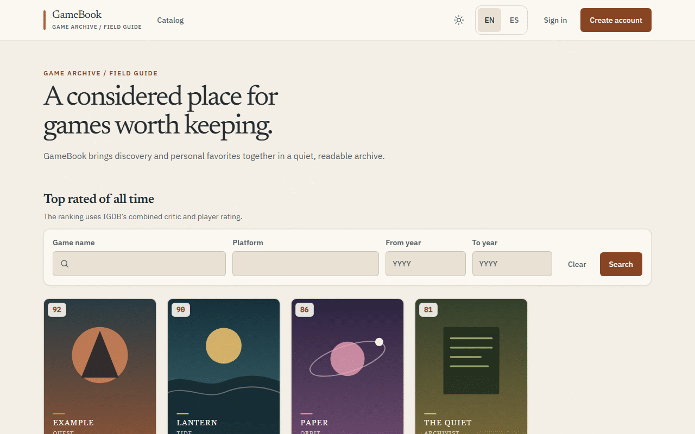
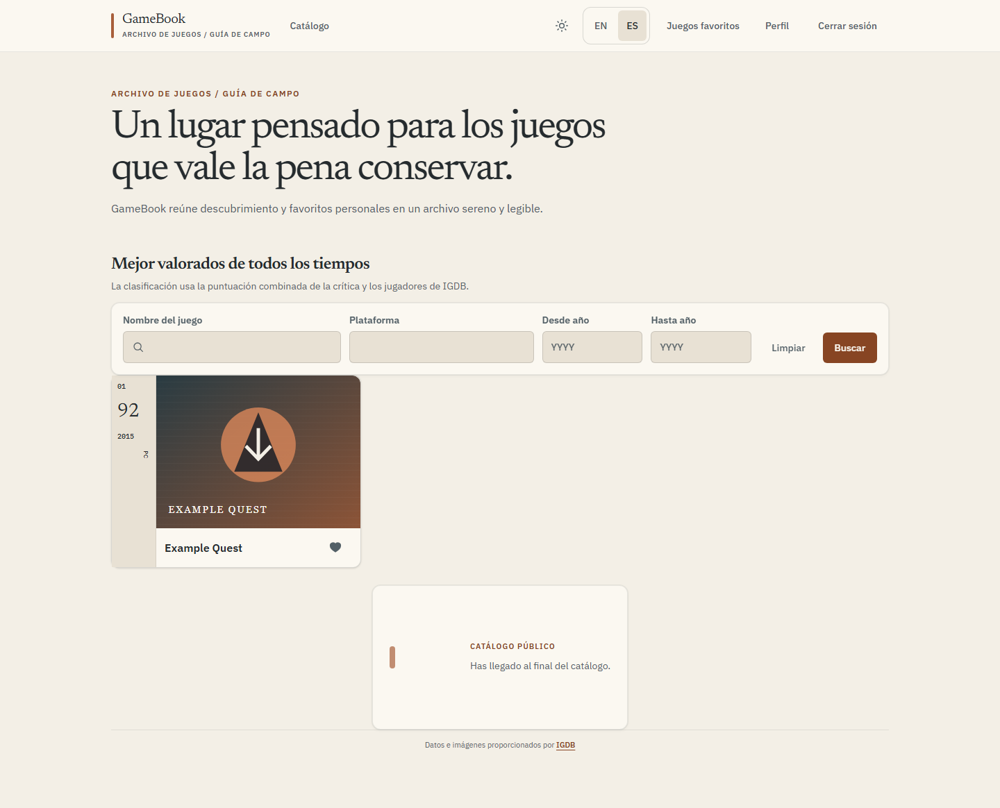
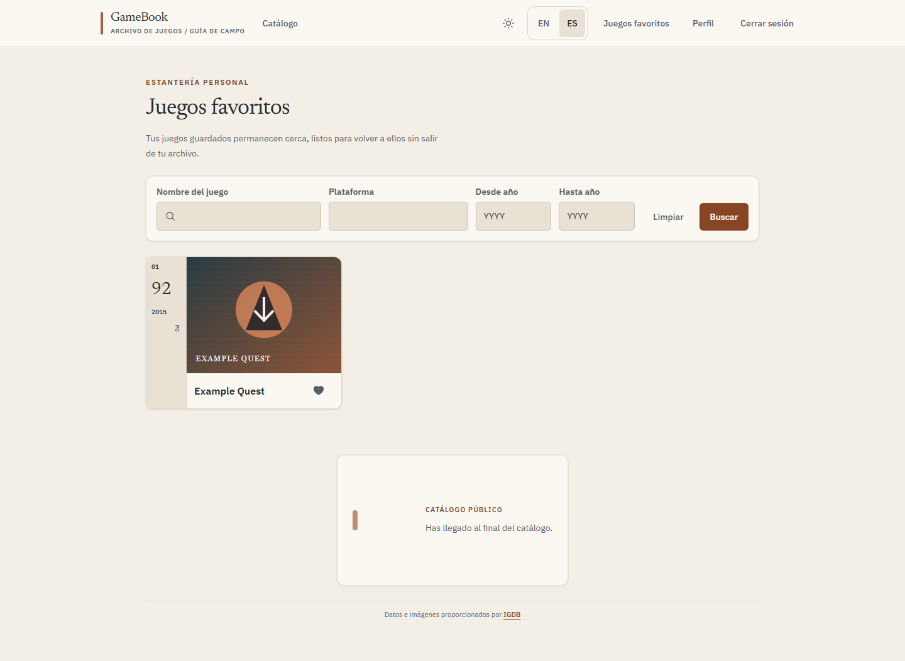
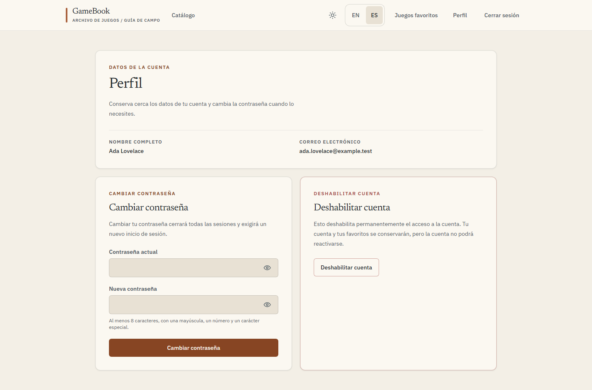
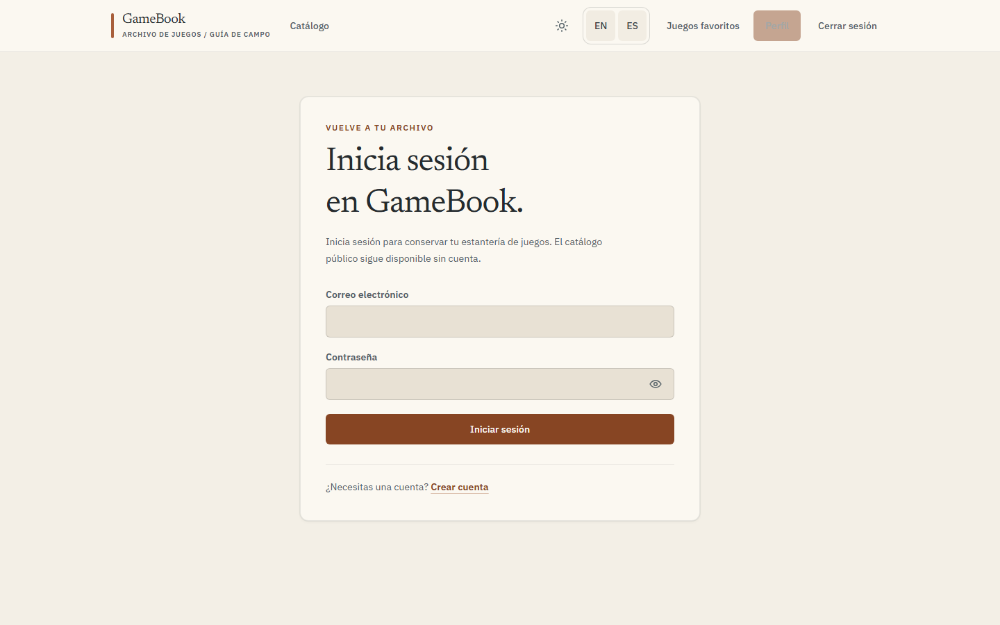

# GameBook.Frontend

[English](README.md) · **Estado: activo — última versión v0.12.0**

[](https://github.com/CarlosSV923/GameBook.Frontend/actions/workflows/ci.yml)



GameBook.Frontend es la aplicación Next.js para consultar información de videojuegos de IGDB y administrar los favoritos de una persona autenticada mediante los servicios de GameBook.

## Qué hace

- Consulta el catálogo público por puntuación, nombre, plataforma y año de lanzamiento, con detalles y sugerencias.
- Permite registrarse, iniciar sesión, consultar el perfil, cambiar la contraseña y desactivar la cuenta.
- Guarda, lista, filtra y elimina los juegos favoritos de una persona después de iniciar sesión.
- Ofrece interfaz en inglés y español, temas claro y oscuro, y diseño adaptable.
- Consulta IGDB desde el servidor Next.js; las credenciales de aplicación de Twitch permanecen en el servidor.

## Demo y documentación de API

**Aplicación:** [gamebook-frontend.vercel.app](https://gamebook-frontend.vercel.app) (Vercel, `main`). La aplicación usa [AuthUser](https://github.com/CarlosSV923/GameBook.Microservice.AuthUser) y [Game](https://github.com/CarlosSV923/GameBook.Microservice.Game); sus interfaces Swagger están en [AuthUser /docs](https://gamebook-microservice-authuser.onrender.com/docs) y [Game /docs](https://gamebook-microservice-game.onrender.com/docs). Ambos backends usan el nivel gratuito de Render, así que la primera solicitud puede tardar; la aplicación muestra un aviso de calentamiento.

## Capturas

Las capturas se generan con `pnpm screenshots` a partir de fixtures ficticios.

| Catálogo                                     | Detalle                                              | Favoritos                                       |
| -------------------------------------------- | ---------------------------------------------------- | ----------------------------------------------- |
|  |  |  |

| Perfil                                     | Inicio de sesión                                                   |
| ------------------------------------------ | ------------------------------------------------------------------ |
|  |  |

## Desarrollo rápido

Requiere Node.js 24 y pnpm (con Corepack). Copia `.env.example` a `.env`, configura valores locales, instala dependencias e inicia la aplicación:

```bash
corepack enable
pnpm install --frozen-lockfile
pnpm dev
```

La aplicación inicia en `http://localhost:3000`. Ejecuta las pruebas unitarias con `pnpm test`. Consulta la [guía de desarrollo](docs/development.es.md) para variables, E2E, capturas y despliegue.

## Arquitectura

La interfaz del navegador se organiza por funcionalidades. Las rutas de servidor de Next.js consultan IGDB con credenciales Twitch exclusivas del servidor; TanStack Query administra el estado de servidor del cliente y los clientes del navegador llaman a AuthUser y Game para cuentas y favoritos.

[](https://carlossv923.github.io/GameBook.Frontend/GameBook.Frontend-architecture-es.html)

[](https://carlossv923.github.io/GameBook.Frontend/GameBook.Frontend-sequence-es.html)

Haz clic en un diagrama para abrir su versión interactiva o consulta el [índice de diagramas](https://carlossv923.github.io/GameBook.Frontend/).

## Tecnologías y decisiones

| Tecnología                            | Motivo                                                                                          |
| ------------------------------------- | ----------------------------------------------------------------------------------------------- |
| Next.js App Router, React, TypeScript | Renderizar en servidor la primera página del catálogo público y proteger las credenciales IGDB. |
| Tailwind CSS 4                        | Sistema único de estilos con tokens de tema.                                                    |
| TanStack Query                        | Gestionar caché y paginación de catálogo, favoritos, detalle y sugerencias.                     |
| Axios y RxJS                          | Clientes HTTP de AuthUser y Game, y comprobaciones de salud observables durante su arranque.    |
| Zod                                   | Validar respuestas IGDB antes de mapearlas a modelos de la aplicación.                          |
| Vitest y Playwright                   | Pruebas unitarias, E2E de navegador y fixtures de capturas repetibles.                          |

## Proyectos relacionados

- [GameBook.System](https://github.com/CarlosSV923/GameBook.System) — documentación del sistema y Compose de integración local.
- [GameBook.Microservice.AuthUser](https://github.com/CarlosSV923/GameBook.Microservice.AuthUser) — cuentas, autenticación y sesiones.
- [GameBook.Microservice.Game](https://github.com/CarlosSV923/GameBook.Microservice.Game) — favoritos de usuario e instantáneas de juegos.

Licencia [MIT](LICENSE) · © Carlos Sesme Vera.
