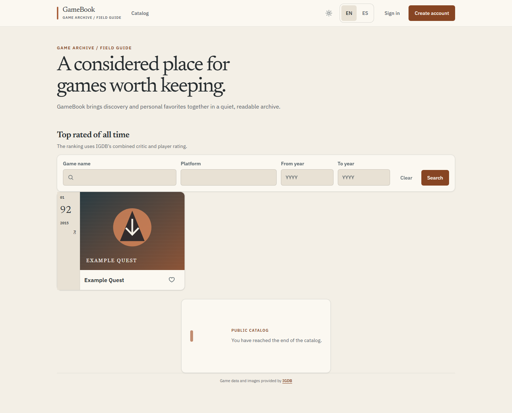
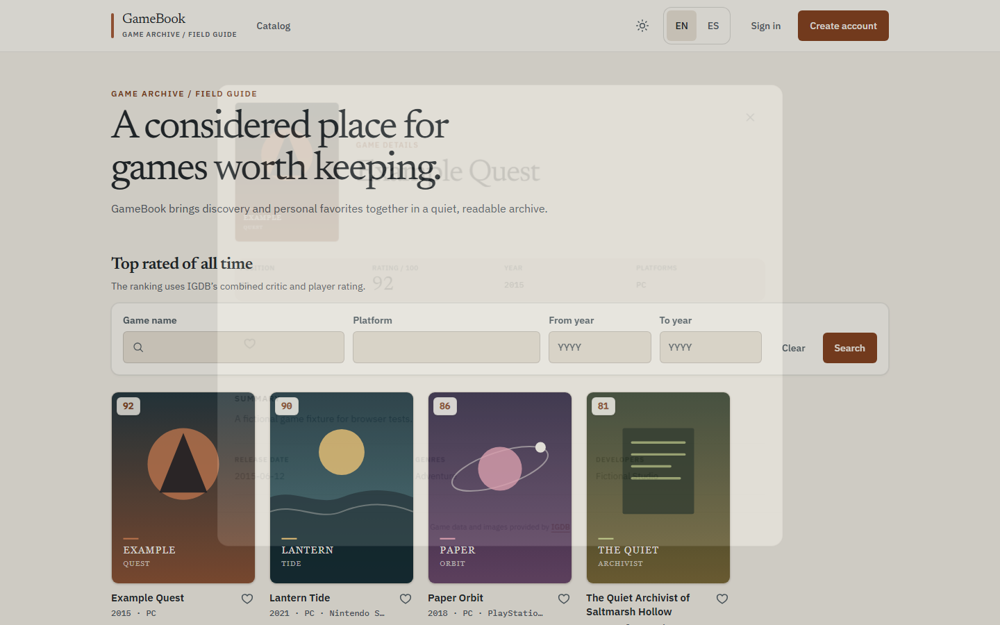
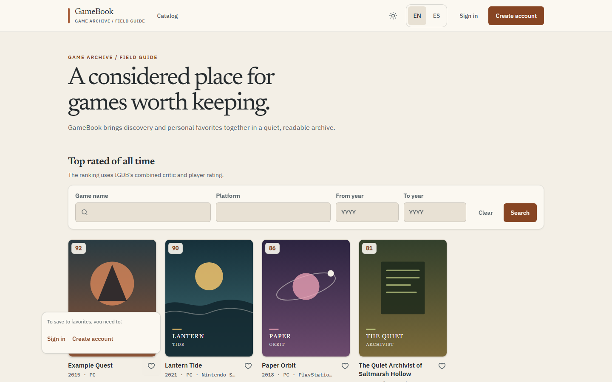
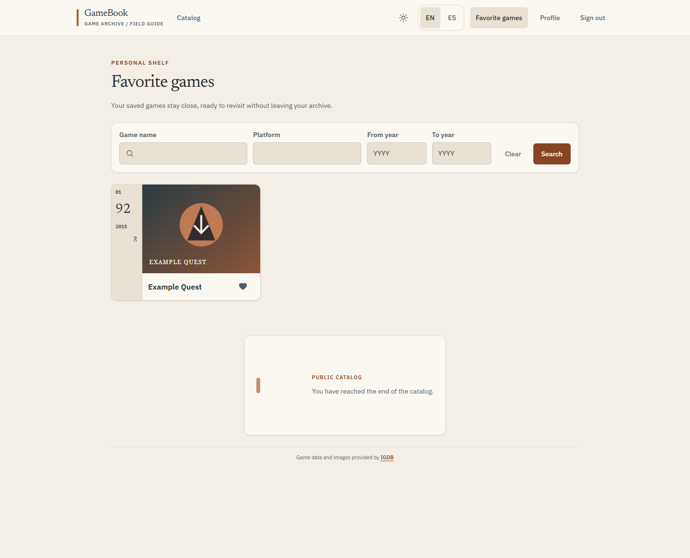
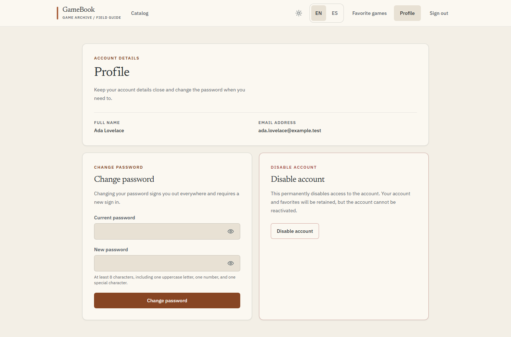
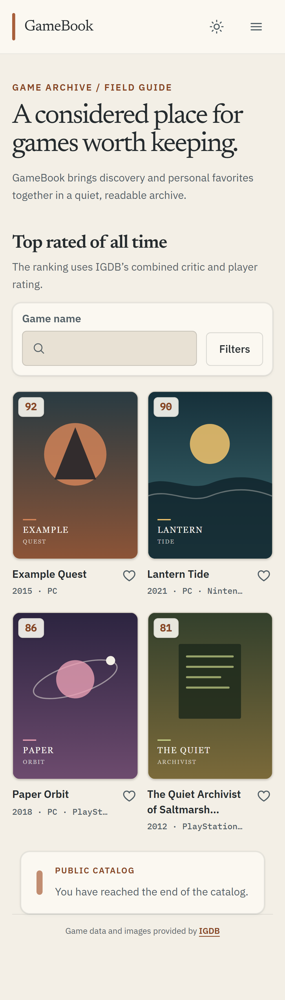

# GameBook.Frontend

[Español](README.es.md) · **Status: active — latest release v0.12.0**

[](https://github.com/CarlosSV923/GameBook.Frontend/actions/workflows/ci.yml)


GameBook.Frontend is the Next.js application for browsing video game information from IGDB and managing a signed-in user's favorites through the GameBook services.

## What it does

- Browses the public catalog by rating, name, platform and release year, with game details and suggestions.
- Lets users register, sign in, view their profile, change their password and deactivate their account.
- Saves, lists, filters and removes a user's favorite games after sign-in.
- Provides English and Spanish interface text, light and dark themes, and responsive layouts.
- Fetches IGDB data on the Next.js server; Twitch application credentials stay server-side.

## Live demo and API docs

**Live app:** [gamebook-frontend.vercel.app](https://gamebook-frontend.vercel.app) (Vercel, `main`). The app uses [AuthUser](https://github.com/CarlosSV923/GameBook.Microservice.AuthUser) and [Game](https://github.com/CarlosSV923/GameBook.Microservice.Game); their Swagger UIs are [AuthUser /docs](https://gamebook-microservice-authuser.onrender.com/docs) and [Game /docs](https://gamebook-microservice-game.onrender.com/docs). Both backends run on Render's free tier, so a first request may take a while; the app shows a warm-up notice.

## Screenshots

Screenshots are generated with `pnpm screenshots` from fictitious fixtures.

| Catalog                                     | Catalog · dark                                                 | Detail                                         |
| ------------------------------------------- | -------------------------------------------------------------- | ---------------------------------------------- |
|  |  |  |

| Anonymous save                                                       | Favorites                                       | Profile                                     |
| -------------------------------------------------------------------- | ----------------------------------------------- | ------------------------------------------- |
|  |  |  |

<p align="center"></p>

## Quick development

Requires Node.js 24 and pnpm (via Corepack). Copy `.env.example` to `.env`, set local values, install dependencies and start the app:

```bash
corepack enable
pnpm install --frozen-lockfile
pnpm dev
```

The app starts at `http://localhost:3000`. Run unit tests with `pnpm test`. See [development guide](docs/development.md) for environment variables, E2E, screenshots and deployment.

## Architecture

The browser UI is organized by feature. Next.js server routes fetch IGDB using server-only Twitch credentials; TanStack Query manages client server-state, while browser clients call AuthUser and Game for account and favorite operations.

[](https://carlossv923.github.io/GameBook.Frontend/GameBook.Frontend-architecture-en.html)

[](https://carlossv923.github.io/GameBook.Frontend/GameBook.Frontend-sequence-en.html)

Click a diagram to open its interactive version, or browse the [diagram index](https://carlossv923.github.io/GameBook.Frontend/).

## Stack and decisions

| Technology                            | Why                                                                                  |
| ------------------------------------- | ------------------------------------------------------------------------------------ |
| Next.js App Router, React, TypeScript | Server-render the first public catalog page and keep IGDB credentials on the server. |
| Tailwind CSS 4                        | Single styling system with theme tokens.                                             |
| TanStack Query                        | Cache and paginate catalog, favorites, detail and suggestions.                       |
| Axios and RxJS                        | HTTP clients for AuthUser and Game, and observable health checks for their warm-up.  |
| Zod                                   | Validate IGDB responses before mapping them to app models.                           |
| Vitest and Playwright                 | Unit tests, browser E2E and repeatable screenshot fixtures.                          |

## Related projects

- [GameBook.System](https://github.com/CarlosSV923/GameBook.System) — system documentation and local integration Compose.
- [GameBook.Microservice.AuthUser](https://github.com/CarlosSV923/GameBook.Microservice.AuthUser) — accounts, authentication and sessions.
- [GameBook.Microservice.Game](https://github.com/CarlosSV923/GameBook.Microservice.Game) — user favorites and game snapshots.

Licensed under the [MIT License](LICENSE) · © Carlos Sesme Vera.
